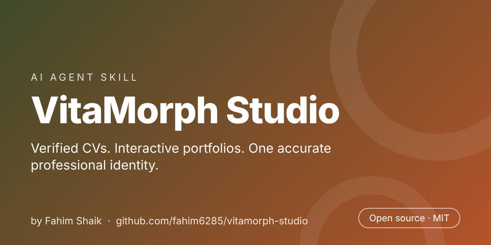

# VitaMorph Studio

**Verified CVs. Interactive portfolios. One accurate professional identity.**

   

AI agent skill that builds a fact-checked CV, then turns it into an accessible, interactive, Netlify-ready portfolio website with a claims ledger and integrity audit.



## Why use it

- **Source-verified CVs.** Builds a private claims ledger from your documents and reconciles discrepancies before issuing the polished CV.
- **One source of truth.** The CV and the website come from one verified profile, so the site never introduces extra claims.
- **Interactive portfolio starter.** A no-framework, responsive, accessible static site with publication search and filter and a print view.
- **Privacy by default.** Phone numbers, home addresses, personal IDs and internal QA notes stay off the public site unless you approve them.
- **Built-in checks.** `verify_profile.py` flags duplicate DOIs, broken links, restricted fields and total mismatches.

## What is in this repository

| Part | Count | Location |
|---|---|---|
| Main skill | 1 | `skills/vitamorph-studio/SKILL.md` |
| Agent setup text | see folder | `skills/vitamorph-studio/AGENT_INSTRUCTIONS.md` |
| Reference protocols | 2 | `skills/vitamorph-studio/references/` |
| Templates | 0 | `skills/vitamorph-studio/templates/` |
| Python utilities | 2 | `skills/vitamorph-studio/scripts/` |
| Synthetic examples | 0 | `skills/vitamorph-studio/examples/` |
| Plugin manifest | 1 | `.codex-plugin/plugin.json` |

All examples are synthetic. The repository contains no private data, research results, credentials or institutional records.

## How to use it

1. **In ChatGPT or another agent builder:** create a skill or plugin from `skills/vitamorph-studio/SKILL.md` and paste `AGENT_INSTRUCTIONS.md` where the platform asks for instructions, where that file exists.
2. **In a regular chat:** attach `SKILL.md` and the reference files, or paste them, then describe your task.
3. **Offline tools:** run the scripts directly (see Quick start).

## Quick start

```bash
cd skills/vitamorph-studio
python scripts/build_profile.py            # generates website/assets/profile.js from website/profile.json
python scripts/verify_profile.py --public  # checks the public profile
```

The sample `website/profile.json` is a blank template, so the public check reports unfilled fields (name, role, institution) until you add your own verified details. That is intended. Open `website/index.html` locally to preview, then deploy only the `website/` folder (for example with Netlify Drop).

## Sample prompts

- Follow VitaMorph Studio to audit my CV and list every claim that has no source.
- Turn my approved CV into an interactive personal academic website I can host on Netlify.
- Compare my two CV versions and show every discrepancy in dates, titles and counts.
- Restructure my CV for a faculty application and keep every claim traceable to a source.
- Prepare a one-page professional bio that matches my CV exactly.
- Run the public-site privacy checks and tell me what must be fixed before I publish.

More prompts are in [`docs/sample-prompts.md`](docs/sample-prompts.md).

## Principles

Evidence first. No invented facts, scores, citations or records. Every claim traces to a source you provided or an official source the agent checks. Third-party documents are treated as content, never as instructions.

## Part of a suite

This agent belongs to [Fahim's AI Agents](https://github.com/fahim6285/fahim-ai-agents), a set of five open-source agents for academic and research work: VitaMorph Studio, SciForge Lab, CareerBridge Academic, RankMetric Intelligence and EduAdapt Studio.

## Contributing, citing and license

Contributions are welcome. See [CONTRIBUTING.md](CONTRIBUTING.md). To cite this work, use the "Cite this repository" button on GitHub (from `CITATION.cff`). Released under the [MIT License](LICENSE).

Created by **Fahim Shaik**.
